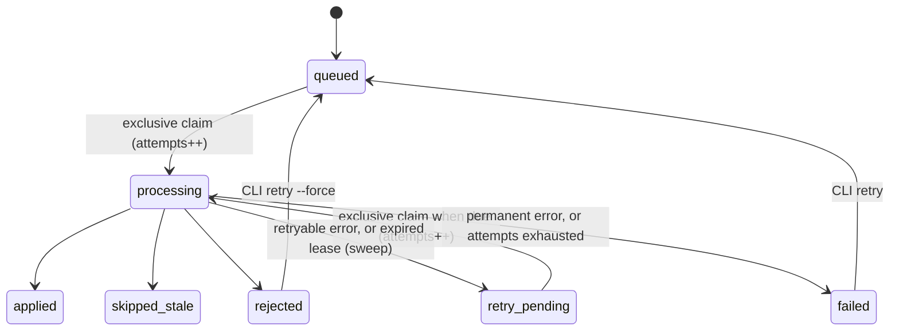
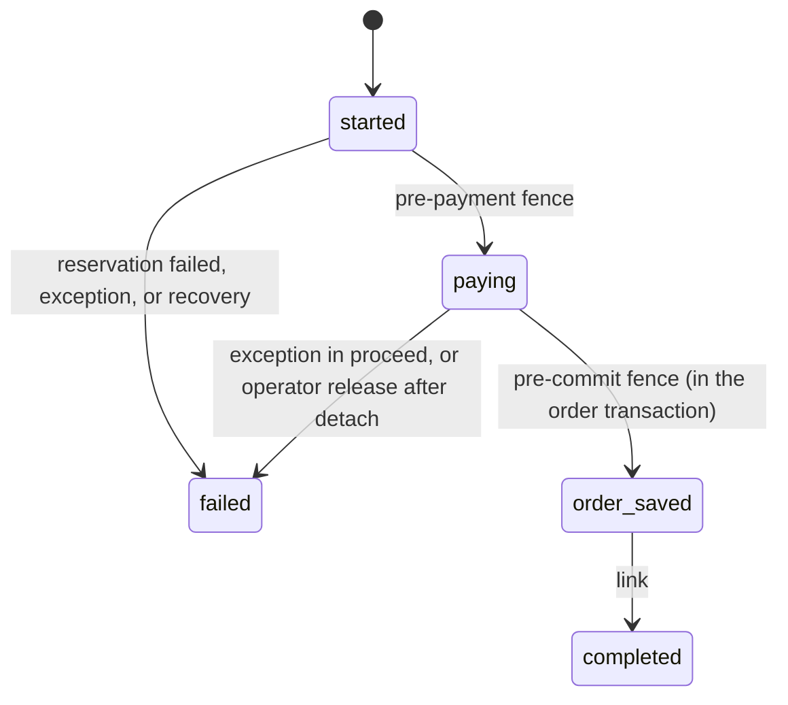
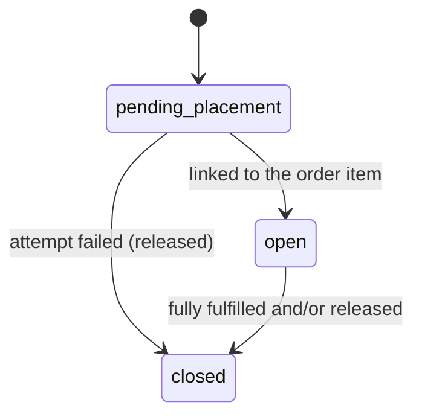

# Architecture

This document explains how `Company_SupplierSync` keeps supplier inventory correct under concurrency, retries and failures. The rules it enforces are in [business-rules.md](business-rules.md).

## Overview

Three flows share one ledger, `company_supplier_inventory`:

1. **Intake (synchronous REST).** Validate, normalize and hash the payload. Insert the update and an outbox row in one transaction. Return a receipt.
2. **Apply (asynchronous queue).** A consumer claims the update exclusively and applies the snapshot under the inventory row lock.
3. **Order placement and lifecycle.** A plugin on `OrderManagementInterface::place` reserves stock before payment; two fences stop a released placement from committing an order. One observer reconciles cancellations, shipments and order closure.

## Spike findings (P2)

Verified on Mage-OS 3.0.0 (Magento 2.4.9), MariaDB 11.4.13. A throwaway probe module (a plugin on `OrderManagementInterface::place` plus logging observers) was run on four placement paths. Each path called the same service contracts its transport uses, in-process:

| Path | Service called |
| --- | --- |
| REST guest cart | `GuestPaymentInformationManagementInterface::savePaymentInformationAndPlaceOrder` (area `webapi_rest`) |
| Storefront checkout | the same, area `frontend` |
| GraphQL `placeOrder` | `Magento\QuoteGraphQl\Model\Cart\PlaceOrder::execute` (area `graphql`) |
| Admin order create | `QuoteManagement::submit` (what `AdminOrder\Create::createOrder` calls, area `adminhtml`) |

Each cart held one simple line and one configurable line.

**Result: go.** The fence design holds on every path.

| Question | Finding | Consequence |
| --- | --- | --- |
| Where does payment run relative to order save? | `OrderService::place()` calls `Order::place()`, which dispatches `sales_order_place_before`, then calls `Payment::place()`. `orderRepository->save()` runs afterwards | The pre-payment fence on `sales_order_place_before` runs before any payment code |
| Transaction level at `place()` entry | 0 on all four paths | Nested-transaction rejection never triggers on supported paths |
| Same order object everywhere (I4) | The object passed to `place()` is the one seen in `sales_order_place_before`, `sales_order_payment_place_start` and `sales_order_save_after`, and is returned by `proceed()` | Stamping `attempt_id` on the order object binds the attempt to that exact order |
| Same connection (I1) | The order resource's connection is the same object as `ResourceConnection::getConnection()` | Module writes inside the fence join the order transaction |
| `sales_order_save_after` inside the transaction | Yes, transaction level 1 (2 or more when called from `ShipOrder` or `DB\Transaction`) | The pre-commit fence commits or rolls back together with the order |
| Fence rejection rolls back (I5) | Throwing in `sales_order_save_after`: no `sales_order` row. Throwing in `sales_order_place_before`: `sales_order_payment_place_start` never fires | A released attempt can neither start payment nor commit an order |
| Are order items persisted when `sales_order_save_after` fires? | **No.** `VersionControl\AbstractDb::processAfterSaves()` calls `afterSave()` (the event) **before** `processRelations()` (items, addresses, payment) | Reservations are linked to order items after `proceed()` returns, not in the fence |
| Exception messages | A `LocalizedException` thrown by the module reaches the caller with its message (wrapped in `CouldNotSaveException` by checkout services) | Customer-safe messages work |
| Concurrent submits of one cart | `QuoteManagement::placeOrder` wraps placement in `CartMutex` | Core already serializes one cart on that path. The attempt check still covers admin create and direct `place()` callers |
| MSI place plugin | `AppendReservationsAfterOrderPlacementPlugin` (around `place`, no `sortOrder`); reserves before `proceed()` only in deferred mode | Independent of ours: if MSI fails inside our `proceed()`, our hold is released |
| Async order placement | `Magento_AsyncOrder` is not installed; `checkout/async` is 0 | The module only logs a warning if `checkout/async` is enabled |

### Configurable products

| Field | Parent order item | Child order item |
| --- | --- | --- |
| `qty_ordered` | 3 | 3 (the child *quote* item has qty 1, relative to the parent) |
| `qty_invoiced`, `qty_refunded` | set | set |
| `qty_shipped`, `qty_canceled` | **set** | **stays 0** |

Consequence: the reservation is keyed on the child (the simple product's SKU, quote item and order item), but every quantity is read from the parent order item.

### Order lifecycle events

| Operation | `sales_order_save_commit_after` | `sales_order_item_save_commit_after` (persisted qty) |
| --- | --- | --- |
| First partial shipment (REST `ShipOrder`), state `new → processing` | fires | fires for each changed item |
| **Second partial shipment** (REST `ShipOrder` and admin `DB\Transaction`), state unchanged | **does not fire** | fires |
| Cancel | fires | fires |
| Invoice | fires | fires |
| Offline credit memo, state `→ closed` | fires | fires |

The order-level event is missed because `VersionControl\AbstractDb::save()` takes `processNotModifiedSave()` when the order row itself is unchanged. That path saves relations but registers no commit callback.

**Decision:** the single lifecycle observer listens to `sales_order_item_save_commit_after`. It fires after commit, for every item whose `qty_shipped`, `qty_canceled`, `qty_refunded` or `qty_invoiced` changed. In the same transaction the order state is also persisted, so reconcile reads both from the database. This replaces the plan's `sales_order_save_commit_after` plus shipment and credit-memo fallbacks with one hook.

**Commit-callback exceptions are swallowed.** `AbstractResource::commit()` runs callbacks in `try/catch` and logs `critical`. A reconcile failure therefore can't break a shipment, but it would be silently missed. The reconciliation cron is the recovery path, not just a nicety.

### Platform checks

| Check | Result |
| --- | --- |
| Nullable `UNIQUE` allows multiple NULLs | Yes (MariaDB 11.4) |
| `SELECT … FOR UPDATE SKIP LOCKED` | Supported (MariaDB ≥ 10.6) |
| Default isolation, lock wait | `REPEATABLE-READ`, `innodb_lock_wait_timeout = 50` |
| `oauth/consumer/enable_integration_as_bearer` | No default in `config.xml`, so off; the README shows how to enable it |
| Custom `WebapiException` with HTTP 409 | Passed through unchanged by `ErrorProcessor::maskException()`; `details` render as `parameters`; `trace` is added only in developer mode |
| Webapi input for `string` parameters | JSON numbers are converted to strings (`49.99 → "49.99"`), and `true` becomes `"1"`. Validation runs on the string form; suppliers should send decimals as strings to avoid float parsing in `json_decode` |

## Components

| Area | Classes | Role |
| --- | --- | --- |
| Service contracts | `Api/*` | Supplier repository, website enablement, assignments, intake, update status, inventory query |
| Intake | `Model/Update/PayloadNormalizer`, `AdmissionValidator`, `UpdateStore`, `StockUpdateManagement` | Syntax and normalization, replay check, admission rules, transactional insert with the outbox row |
| Queue | `Model/Queue/UpdatePublisher`, `OutboxDispatcher`, `UpdateConsumer`, `RetryScheduler`, `UpdateSweeper`, `FailureClassifier`; `Model/Update/SnapshotApplier` | Publication, exclusive claim, apply, retry, recovery |
| Ledger | `Model/Inventory/InventoryLedger`, `Model/Reservation/ReservationLedger` | Row locks, counters, events; reserve, release, fulfil, link, reconcile |
| Placement | `Plugin/PlaceOrderPlugin`, `Observer/PrePaymentFence`, `Observer/PreCommitFence`, `Model/Placement/*` | Attempts, holds before payment, fences, recovery by attempt status |
| Lifecycle | `Observer/ReconcileOrderItem`, `Model/Placement/Reconciliation`, `Cron/*` | Reconcile on item commits; safety-net crons |
| Shared | `Model/Db/TransactionRunner`, `StateTransitionValidator`, `Decimal`, `Logger/*` | Module-owned transactions with deadlock retry, the single transition matrix, bcmath, dedicated log |

Hot paths use `ResourceConnection` and explicit SQL rather than models: row locks (`FOR UPDATE`, `SKIP LOCKED`) and absolute counter writes cannot be expressed through Magento's model save. Suppliers, which have no concurrency concerns, use a standard model, resource model and repository.

## Transaction boundaries and lock order

**Global lock order:** update row → placement attempt rows → inventory rows → reservation rows, each set in ascending id order. Every module transaction takes the subset it needs in this order, so module transactions cannot deadlock with each other. `TransactionRunner` still retries a unit of work up to three times on an InnoDB deadlock, because Magento's own transactions (order save) also touch rows we lock.

`TransactionRunner` refuses to start inside another transaction. Magento's nested "transactions" are only a counter: an inner rollback would not undo the caller's work, and an inner retry would re-run part of it. The pre-commit fence is the one deliberate exception: it runs inside the order transaction, on purpose, and does not use the runner.

| Transaction | Locks (in order) | Writes |
| --- | --- | --- |
| Intake insert | — (the `UNIQUE(supplier_id, idempotency_key)` insert is the arbiter) | update row with watermark, outbox row, audit event |
| Consumer tx1 (claim) | update | `processing`, `claim_token`, `lease_until`, `attempts + 1`, audit |
| Consumer tx2 (apply) | update → inventory (created with `INSERT … ON DUPLICATE KEY UPDATE`, which takes the exclusive lock directly) | inventory snapshot, terminal status, audit; only if `claim_token` still matches |
| Consumer tx3 (retry) | update | `retry_pending` + `next_attempt_at` + outbox `next_publish_at`, or `failed`; only if the token still matches |
| Dispatcher claim | outbox rows (`FOR UPDATE SKIP LOCKED`) | `claim_token`, `claimed_until`; publishing happens after commit |
| Sweep | update (`SKIP LOCKED`, re-checked under lock) | `retry_pending`/`failed` for expired claims; rearmed outbox for lost messages |
| Settle prior attempts | attempts of the quote | recovery of expired ones (may release or detach) |
| Reserve | attempt → inventory → (inserts) | `reserved_qty`, reservations, `reserve` events |
| Pre-payment fence | attempt (single conditional `UPDATE`, autocommit) | `started → paying` |
| Pre-commit fence | attempt, inside the order transaction | `paying → order_saved`, `order_id` |
| Link / fail / recover | attempt → inventory → reservations | link, release, detach, attempt status |
| Reconcile order | inventory → reservations | fulfil and release deltas, events |

### Consistent reads versus locking reads

MariaDB and MySQL default to REPEATABLE READ: a transaction's first plain `SELECT` fixes its snapshot, and later plain reads do not see rows committed after that point. Locking reads (`FOR UPDATE`, `LOCK IN SHARE MODE`) always read the latest committed row.

The concurrent-first-apply scenario caught this. Two consumers applied the first two updates of a new SKU. The second one blocked on the first one's insert, then looked the new row up with a plain read, could not see it, and failed permanently, so the older snapshot could win. The rule since then:

- Anything a decision depends on is read with a locking read: inventory rows by unique key or id, attempt rows, reservation rows, and the pending-fulfilment sum (`LOCK IN SHARE MODE`).
- Plain reads are used only where staleness is harmless and documented:
  - choosing which reservation ids to lock (a reservation's inventory id never changes);
  - the intake watermark (errs toward under-selling);
  - reading order-item quantities in reconcile. The snapshot is taken after the triggering commit, deltas are bounded by `min()`, and a later commit triggers its own reconcile.

## Hooks

| Hook | Why it is needed |
| --- | --- |
| Around plugin on `OrderManagementInterface::place` | The only point that wraps payment and order save on every supported path, so holds can be taken before payment and settled after. MSI uses the same interception point |
| Observer `sales_order_place_before` (pre-payment fence) | Fires in `Order::place()` immediately before `Payment::place()`; a released attempt never starts payment |
| Observer `sales_order_save_after` (pre-commit fence) | Fires inside the order save transaction; rejecting there rolls the order back (I5) |
| Observer `sales_order_item_save_commit_after` (reconcile) | The only event that fires, with persisted quantities, for every shipment, cancellation, invoice and credit memo (see spike findings) |
| Cron `supplier_sync_outbox_dispatch` (every minute) | Publication retries and crash recovery for the queue |
| Cron `supplier_sync_reconcile` (every 5 minutes) | Links saved orders, recovers expired attempts, re-runs reconcile in case a commit callback failed (core swallows those exceptions) |

No core files are changed, and no preferences replace core classes.

## State machines

All transitions go through `StateTransitionValidator`; the full matrices are unit-tested.

### Update

Retry budget is spent only by a successful claim. A delivery that arrives during a valid claim, before `next_attempt_at`, or after a terminal status is acknowledged with no effect.

### Placement attempt

Recovery detaches an expired `paying` attempt (`detached_at` set, hold kept) without changing its status.

### Reservation

The counters `qty_reserved`, `qty_fulfilled` and `qty_released` are authoritative; the status is derived from them.

## Invariants

**No supplier oversell from placement**, provided I1–I5 hold:

| Invariant | Enforced by | Proven by |
| --- | --- | --- |
| I1 The order save and the attempt fence share one connection and transaction | Runtime identity check in `PreCommitFence` | Spike; "order save fails after the pre-commit fence" scenario |
| I2 Every supported path runs both fences | The pre-commit fence accepts only `paying`, so a path that skips the pre-payment fence fails instead of committing | Spike on four paths; "a path that skips the pre-payment fence cannot commit" scenario |
| I3 Every resolver locks the attempt row before changing it | All attempt writes after creation go through `AttemptResolver` (or the two fences) | Code review; recovery scenarios |
| I4 The attempt is bound to the exact order being saved | Attempt id stamped on the order object; non-data-object orders are refused | Spike |
| I5 A pre-commit rejection rolls the order back atomically | Throwing inside `sales_order_save_after` | Spike; "late commit after operator release is rejected" scenario |

## Test map

| Plan area | Where |
| --- | --- |
| Supplier uniqueness, disabled suppliers and websites, website isolation | CLI smoke test (P3); `rest-scenarios.php`; `placement-scenarios.php` "disabled suppliers" |
| Invalid qty, price, scale, key, currency, SKU, type, website, assignment | `rest-scenarios.php`; intake checks recorded in P5 |
| Unauthorized requests and ACL | `rest-scenarios.php` "Authentication and ACL" |
| Identical retries, conflicting keys, concurrent identical submissions | `rest-scenarios.php`; `queue-scenarios.php` "Concurrency" |
| Duplicate and out-of-order messages | `queue-scenarios.php` "Apply and ordering", "Duplicate deliveries" |
| Publication failure, lost messages, abandoned dispatcher claims | `queue-scenarios.php` "Lost and unpublished messages" |
| Consumer interruption, takeover, lock ownership | `queue-scenarios.php` "Crash after claim", "Takeover", "Sweep never steals…" |
| Retry exhaustion and recovery | `queue-scenarios.php` "Poison message" |
| Duplicate reservations, multi-line aggregation, configurables | `placement-scenarios.php` |
| Payment failure, order save failure, exception after commit | `placement-scenarios.php` |
| Crash recovery for each attempt state | `placement-scenarios.php` "Recovery by attempt state", "Slow payment" |
| Full, partial, repeated and concurrent cancellations; refunds; shipments | `placement-scenarios.php` "Order lifecycle" |
| Snapshot examples 4 and 6, lag window, shortage, reassignment | `placement-scenarios.php` |
| Concurrency proof (20 against 10) | `Test/Concurrency/reserve-burst.php` |
| Safe logging | `rest-scenarios.php` "Safe logging" |
| Transition matrices, decimal math, status derivation | `Test/Unit` |

The scenario harnesses replace Magento's integration-test framework for everything that needs real concurrency: that framework wraps tests in a transaction that other processes cannot see. They run against a real install and assert on persisted rows.

## Deviations from the plan

| Plan | Implemented | Why |
| --- | --- | --- |
| Lifecycle hook `sales_order_save_commit_after` (+ shipment/credit memo fallbacks) | `sales_order_item_save_commit_after` only | The spike showed the order-level event is skipped for a second partial shipment, and the shipment event fires before item quantities are saved on the REST `ShipOrder` path |
| `403` for a token without the ACL resource | Magento's `401` | Core behaviour; the module does not override authorization errors |
| Reservation table as planned | Adds `qty_source_item_id` | Configurable children carry no shipped or cancelled quantities; the parent item does |
| Primary concurrency harness as a PHPUnit integration test | Standalone harness scripts | The integration framework's transaction wrapping hides fixtures from child processes; the target environment also had no separate test database |
| Logger as a virtual type of Magento's logger | A dedicated logger class | A virtual type inherits core handlers, duplicating module logs into `system.log` and `exception.log` |

## Extensions

- **Multi-supplier routing.** Replace the one-supplier assignment with a ranked list per SKU and website. `LineResolver` would choose the first supplier with enough `available` while holding the inventory locks. Reservations already reference their inventory row, so releases and fulfilments need no change. Splitting one order line across suppliers would need one reservation per (line, supplier).
- **Supplier revision.** A supplier-side revision or `reflects_shipments_until` timestamp in the payload would replace the lag window: apply only if newer than the last applied revision, and clear pending fulfilment up to the stated time.
- **Supplier confirmations.** Publish reserve, release and fulfil events to an outbound topic from the same transactions (outbox pattern) so suppliers can confirm holds.
- **Cost attribute.** Copy `unit_cost` to the product `cost` attribute on apply, per website scope.
- **Cart-level availability.** Show supplier availability in the cart and product page; today only placement enforces it.

## Production hardening

- Run the consumer under a supervisor with `--max-messages` so it restarts regularly; size `lease_seconds` above the lock-wait timeout plus apply time.
- Alert on `failed` updates, on `attempt:list --detached`, and on shortages (warning lines in `supplier_sync.log`).
- Purge or archive `company_supplier_update_event` and `company_supplier_reservation_event` on a schedule. Keep fulfil events at least `max_lag_seconds` back and down to the oldest pending watermark.
- Rate-limit the intake endpoint per integration.
- Reconcile payments for detached attempts with the gateway's own tooling or webhooks.
